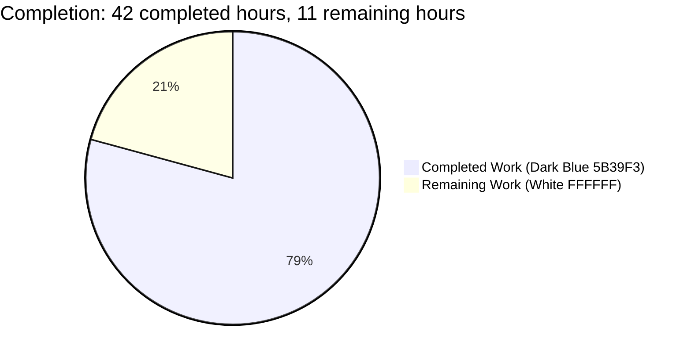
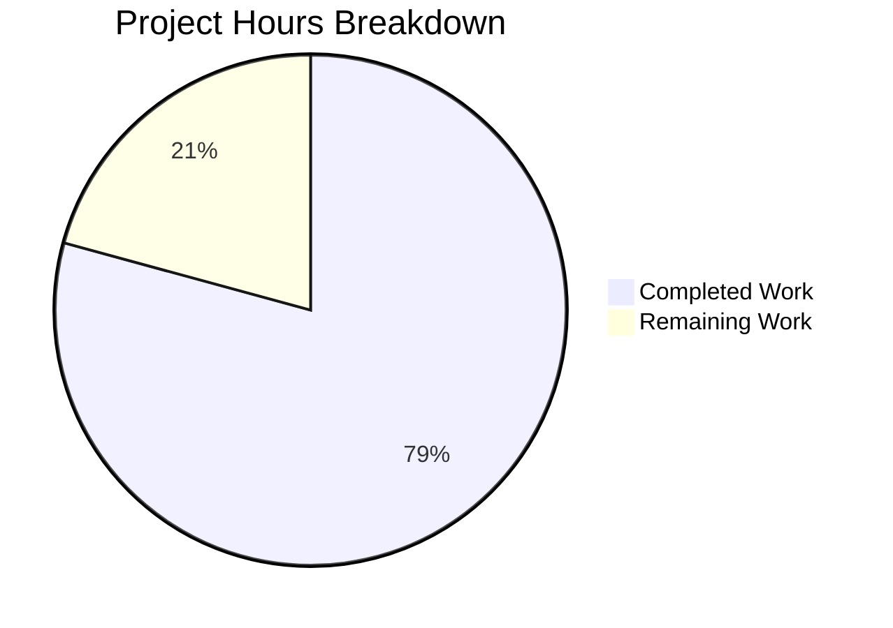

# 1. Executive Summary

## 1.1 Project Overview

A single-file Node.js HTTP service that doubles as a teaching artifact: `GET /hello` answers `Hello world`, every other request answers `Not Found`, each request writes one stdout line, the port comes from `PORT` with strict validation, failures are reported actionably, and `CTRL+C` shuts down cleanly. It targets developers learning the built-in `node:http` module and teams contrasting a framework-free server with Express or Fastify.

The product is 436 lines across `server.js` (228 lines, 18 functions), `package.json` (seven fields) and `README.md` (the tutorial) — no build step, no framework, no dependency.

## 1.2 Completion Status

Verified work: **42 of 53 project hours — 79.2% complete**; 11 hours of verification and hardening remain.

`Completion = 42 completed hours / (42 completed + 11 remaining) x 100 = 79.2%`



| Metric | Value |
| --- | --- |
| Total Hours | 53 |
| Completed Hours (AI + Manual) | 42 |
| Remaining Hours | 11 |
| Completion | 79.2% |

Dark Blue (`#5B39F3`) marks completed hours; White (`#FFFFFF`) marks remaining.

## 1.3 Key Accomplishments

- Routing on method plus resolved pathname: `GET /hello` answers `200 Hello world` with the fixed five-header set.
- One shared catch-all answers `404 Not Found` with byte-identical bodies for any other path or method, including rejected and oversized requests.
- One stdout line per request, emitted before dispatch, with no query string or fragment in the path field.
- `PORT` validation (default 3000, digits-only, 1024–65535) with the exact rejection on stderr and exit 1; bind failures reported without a stack trace; `SIGINT` drains connections and exits 0.
- Zero dependencies and a closed boundary: one standard-library import, no filesystem access, no outbound request, no body read.
- 128 checks — 17 acceptance criteria, 12 routing rows, six catch-all forms and the performance measurements — all passing, median latency 0.6 ms against the 10 ms budget.

## 1.4 Critical Unresolved Issues

**4 of 18 requirements carry an open item** — a runtime condition this environment cannot reach, or a hardening step beyond the current delivery scope.

| Issue | Impact | Owner | ETA |
| --- | --- | --- | --- |
| The declared runtime floor (Node 18.0.0 / 18.1.0) cannot be exercised here, so the guarded `closeIdleConnections` path has never run | Portability assurance on the oldest supported runtime is static only; on 18.0.0/18.1.0 an idle keep-alive socket can delay process exit, with the exit status unaffected | Platform / CI owner | Next maintenance window (3.5 h) |
| A connection that never completes a request holds the process open after `SIGINT` until the client disconnects | A client can delay shutdown indefinitely; the shutdown line is printed and the exit status stays 0 | Backend owner | Before first production deployment (3 h) |
| The non-`EADDRINUSE` bind-failure message has no reachable trigger on this product | The literal is verified against its source template only, never observed at runtime | Backend owner | Next maintenance window (2 h) |
| A stdout consumer that disappears turns the next log write into an unhandled `EPIPE`, and the authority of a malformed target is recorded verbatim in the log field | Process death when stdout is piped to a short-lived reader; log consumers see arbitrary target bytes | Backend owner | Before first production deployment (2.5 h) |

## 1.5 Access Issues

| System/Resource | Type of Access | Issue Description | Resolution Status | Owner |
| --- | --- | --- | --- | --- |
| Node.js 18.0.0 / 18.1.0 runtime | Runtime availability in the validation environment | Only Node.js v22.23.3 is installed and no other runtime may be installed in this environment, so the declared floor's guarded shutdown path cannot be exercised | Open — needs a CI runner or container image pinned to Node 18.0.0 | Platform / CI owner |

No other access issue applies: no credential, database, cache or external service is needed, and no variable other than `PORT` is read.

## 1.6 Recommended Next Steps

1. [Medium] Exercise the battery on Node.js 18.0.0 and 18.1.0 in a pinned CI job.
2. [Medium] Bound the graceful shutdown against a connection that never completes a request.
3. [Low] Confirm or accept the non-`EADDRINUSE` bind-failure message.
4. [Low] Harden the log path against a vanished stdout consumer, and settle the malformed-target authority question.

# 2. Project Hours Breakdown

Hours are scoped to the product's agreed requirements — the eleven functional and seven non-functional requirements it was specified against — plus the activities needed to operate the delivered service.

## 2.1 Completed Work Detail

| Component | Hours | Description |
| --- | --- | --- |
| Routing, response contract and shared catch-all | 10 | Method plus resolved-pathname dispatch, the one response writer, the two route handlers, the exact-case/query-stripped comparison, and the byte-identical 404 for a path miss and a method miss (`server.js` 18–30, 103–115) |
| Per-request logging across all three request paths | 6 | `logRequest`, the printable-ASCII field guard and the shared path resolver, wired into the routed listener, the parser-rejected recovery path and the diverted `CONNECT` path (`server.js` 74–101, 108, 143) |
| Coverage of parser-rejected, diverted and oversized requests | 7 | The `clientError` and `connect` listeners, the socket-framed 404 writer with its `'error'` guard, and the already-answered guard that keeps one response and one log line per request (`server.js` 35–53, 122–146, 214–215) |
| Port configuration and validation | 4 | `PORT` read from the environment, default 3000, digits-only integer range 1024–65535, and the actionable rejection with exit status 1 (`server.js` 148–174, 222–228) |
| Startup line and bind-failure reporting | 3 | The listening line emitted after the socket is bound, and the `'error'` listener that distinguishes a port already in use from any other cause (`server.js` 176–188, 206–210) |
| Graceful shutdown | 3 | The `SIGINT` listener, the shutdown line, the guarded `closeIdleConnections()` call and the close-then-exit-0 sequence (`server.js` 190–200, 217) |
| Manifest and entry point | 1 | The seven-field `package.json` with the `node server.js` start script and the `>=18.0.0` floor (`package.json`) |
| Tutorial documentation | 4 | Purpose, prerequisites, installation, execution, the `curl` walkthrough, expected output, shutdown, `PORT` configuration and the routing table (`README.md`) |
| Acceptance verification of the delivered behaviour | 4 | The 17 acceptance criteria plus the routing table, the catch-all forms and the performance and memory measurements, run gate by gate from the shell |
| **Total** | **42** | Equals Completed Hours in Section 1.2 |

## 2.2 Remaining Work Detail

| Category | Hours | Priority |
| --- | --- | --- |
| Runtime-floor verification on Node 18.0.0 / 18.1.0, including the guarded `closeIdleConnections` path | 3.5 | Medium |
| Bounded graceful shutdown so a non-completing connection cannot hold the process open after `SIGINT` | 3 | Medium |
| Confirmation or formal acceptance of the non-`EADDRINUSE` bind-failure message | 2 | Low |
| Log-path resilience against a vanished stdout consumer, and the decision on a malformed target's authority | 2.5 | Low |
| **Total** | **11** | Equals Remaining Hours in Section 1.2 |

# 3. Test Results

The project ships no test framework by design: it is a three-file, zero-dependency deliverable whose verification lives in shell commands. Every number below comes from a single reference run of those commands against the delivered commit, executed on the running process — **128 checks, 128 passed, 0 failed**.

| Area / Category | Framework | Tests | Passed | Failed | Coverage | What This Proves |
| --- | --- | --- | --- | --- | --- | --- |
| Routing and response contract (greeting route, catch-all, 12 routing rows, 6 catch-all forms, header and body set) | shell — `curl` and raw TCP request lines | 51 | 51 | 0 | n/a — no coverage tool ships with the project | The status, the `Content-Type`, the `Content-Length` (11/9) and the body are exactly as specified for every request form the parser admits, including parse-failure targets and forms the parser rejects |
| Per-request logging | shell — stdout capture and format assertion | 15 | 15 | 0 | n/a | Exactly one well-formed line per request, emitted before dispatch, with no query string or fragment in the path field and no non-upper-case method field |
| Port configuration and rejections | shell — process exit statuses and stderr comparison | 24 | 24 | 0 | n/a | The default, the override, the accepted range and all seven rejected values behave identically on every run, with the exact message and exit status 1 |
| Default-port startup | shell — process spawn and stdout capture | 5 | 5 | 0 | n/a | The service binds port 3000 when `PORT` is unset and prints the startup line only after the socket is bound |
| Graceful shutdown | shell — `SIGINT` to the spawned pid with exit status capture | 3 | 3 | 0 | n/a | `SIGINT` prints the shutdown line, drains connections, leaves stderr empty and exits with status 0 |
| Bind-failure reporting | shell — second instance on an occupied port | 6 | 6 | 0 | n/a | The port-in-use failure is reported on stderr with the exact message, stdout stays empty, no stack trace appears, and the running instance keeps serving |
| Performance and stability | shell — `curl` timings, `xargs -P 20`, `ps -o rss=` | 12 | 12 | 0 | n/a | Median 0.6 ms and maximum 3.8 ms against the 10 ms budget, 100 of 100 concurrent requests answered, and resident memory flat across 2 000 requests with 2 120 log lines |
| Static gate, manifest, dependency tree and documented entry point | `node --check`, `npm ls --all`, `npm start` | 12 | 12 | 0 | n/a | The module parses, the dependency tree is empty, the manifest carries its seven fields, and the documented `npm start` entry point serves the greeting |

**Not Covered**

- **The declared runtime floor (Node 18.0.0 / 18.1.0).** No such runtime exists in this environment and installing one is prohibited, so the guarded `closeIdleConnections` branch has never executed. Before release, run the battery on that runtime, or on both floor releases, in a pinned container.
- **The non-`EADDRINUSE` bind-failure branch.** It is unreachable by construction — ports below 1024 are refused before a socket exists and `listen()` takes no host argument — so its message has been compared with the source template but never observed. Confirm it in a constrained environment or record it as unreachable.
- **A stdout consumer that disappears while the service is running.** No check covers the `EPIPE` that the next log write raises, or its effect on the process.
- **Behaviour on a runtime below the declared floor.** `engines.node` is advisory, so nothing refuses an older runtime; that path is untested and unsupported.
- **No coverage percentage is reported.** The project ships no coverage tooling and no instrumentation, so line or branch coverage cannot be measured; the figure that would normally sit in the Coverage column does not exist for this delivery.

# 4. Runtime Validation & UI Verification

Every line below was driven against the running service — a spawned `node server.js` process, real TCP clients and real signals.

- ✅ **Default-port startup** — binds 3000 with `PORT` unset, prints `Server listening on port 3000` after the socket is bound, serves the greeting, exits 0 on `SIGINT`.
- ✅ **Greeting route end to end** — `GET /hello` returns `200`, `Content-Type: text/plain`, `Content-Length: 11` and the body `Hello world`; the header set is exactly `Content-Type`, `Date`, `Connection`, `Keep-Alive`, `Content-Length`.
- ✅ **Catch-all 404 and the routing table** — an unmatched path, an unmatched method on `/hello`, a target the `URL` constructor rejects, a parser-rejected request line, a diverted `CONNECT` and a 20 006-byte target all answer `404 Not Found` with `Content-Type: text/plain` and `Content-Length: 9`, and all twelve documented routing rows produce the specified status, body and logged path.
- ✅ **Per-request logging** — one line per request in `[ISO-8601] [METHOD] [path]` from the routed listener, the parser-rejected recovery path and the diverted `CONNECT` path; no line carries a query string or fragment.
- ✅ **Port configuration** — `PORT=8080` binds and serves with the matching startup line; `abc`, `3000.5`, `3000abc`, `1e3`, `80`, `1023` and `65536` each exit 1 with an empty stdout and the exact stderr message.
- ✅ **Bind failure** — a second instance on an occupied port exits 1 with an empty stdout and the exact port-in-use message, without a stack trace, while the holder keeps serving.
- ✅ **Graceful shutdown** — `SIGINT` prints `Shutting down server on port <port>`, leaves stderr empty and exits 0, with the port released.
- ✅ **Documented entry point** — `npm start` prints the startup line, serves the greeting, and shuts down cleanly when the signal reaches its `node` child.
- ✅ **Performance and stability** — 20 latency samples (min 0.000349 s, median 0.000617 s, max 0.003773 s), 100 of 100 concurrent requests answered `200`, and resident memory flat across two 1 000-request loops.
- ⚠ **Declared runtime floor** — Node 18.0.0 / 18.1.0 is not available in this environment, so the guarded `closeIdleConnections` path was never exercised; everything was exercised on Node v22.23.3.

**Never exercised at runtime:** the oldest-floor shutdown branch above; the non-`EADDRINUSE` bind-failure message, which no configuration on this product can trigger; and the loss of the stdout consumer mid-run. There is no user interface to verify — the service returns two plain-text bodies and serves no markup, stylesheet, script or asset — so no screen, browser flow or accessibility surface exists, and there are no external integrations to exercise: the service makes no outbound request, consumes no external contract, and needs no credential or service endpoint.

# 5. Compliance & Quality Review

The delivered capability is measured against the requirements it was specified against: eleven functional requirements (FR1–FR11) and seven non-functional requirements (NFR1–NFR7), plus the seventeen acceptance criteria and the two adopted checks that evidence them.

## 5.1 Compliance Matrix

| # | Deliverable | Requirement | Status | Evidence |
| --- | --- | --- | --- | --- |
| 1 | Greeting endpoint | FR1 | ✅ Pass | `server.js` 24–26, 110–111; observed `200`, `text/plain`, `Content-Length: 11`, body `Hello world` |
| 2 | Catch-all 404 for any other method or path | FR2, FR3 | ✅ Pass | `server.js` 28–30, 110–115, 122–146; 404 for a path miss, a method miss, parser-rejected, diverted and oversized requests |
| 3 | Per-request logging before dispatch | FR4 | ✅ Pass | `server.js` 78–80, 108, 143; 23 lines for 23 requests and 2 120 for 2 120, all in the required format |
| 4 | Startup line and `PORT` configuration | FR5, FR6 | ✅ Pass | `server.js` 148–174, 208–210; four ports bound correctly; seven rejected values exit 1 with the exact message |
| 5 | Graceful shutdown on `SIGINT` | FR7 | ✅ Pass (coverage caveat) | `server.js` 190–200; shutdown line, empty stderr, exit 0 — a non-completing connection can delay the exit (Section 5.2, row 5) |
| 6 | Bind-failure reporting | FR8 | ✅ Pass | `server.js` 176–188, 206; occupied port exits 1 with the exact message, no stack trace, holder still serving |
| 7 | Response disclosure boundary | FR11 | ✅ Pass | Only two literal bodies ever observed; no message, path, port or stack trace in any header or body |
| 8 | Manifest, entry point and dependency tree | FR9, NFR7 | ✅ Pass | `package.json` seven fields; `npm start` serves the greeting; `npm ls --all` empty, no `node_modules` |
| 9 | Tutorial documentation | FR10 | ✅ Pass | `README.md` covers all eight required topics plus the routing table, and every documented literal matches the emitted text |
| 10 | Latency, concurrency and memory envelope | NFR1, NFR2, NFR3 | ✅ Pass | Median 0.000617 s and max 0.003773 s against 0.010 s; 100/100 concurrent 200s; RSS flat across 2 000 requests |
| 11 | Security boundary and code quality | NFR4, NFR5 | ✅ Pass | One standard-library import; no `eval`, `fs`, outbound request or body read; 18 purpose-named functions, no dead code, comments only where non-obvious |
| 12 | Portability to the declared runtime floor | NFR6 | ⚠ Partial coverage | Every API in use exists at 18.0.0 and the one later call is guarded (`server.js` 195–197); the guarded branch cannot be exercised on the only installed runtime |

## 5.2 AAP & Rule Divergences and Gaps

Eight departures from the specification were identified; two were asked for by the specification itself and are marked Sanctioned. No user-specified rules exist for this project, so no rule can be departed from.

| # | What the Spec Required | What Was Delivered Instead | Why It Diverged | Impact | Remediation |
| --- | --- | --- | --- | --- | --- |
| 1 | A fixed function set of eleven named functions and seven constants (`server.js` 0.5.1) | 18 functions and two module-scope bindings (`server`, `activePort`) at `server.js` 14–16 | The fixed set has no handler for a request the parser rejects or a `CONNECT` Node diverts, and its helpers assume a `ServerResponse`; the shutdown handler is fixed zero-argument yet must name the port it closes | None on behaviour; three files, nothing renamed or removed | None required |
| 2 | Only status and `Content-Type` set by the source; Node adds the rest; never an explicit `Content-Length` | The third response is framed by hand on the socket with `Content-Type`, `Date`, `Content-Length: 9`, `Connection: close` (`server.js` 44–52) | Those requests have no `ServerResponse`; a body needs a length or a close-delimited frame, and a connection whose parse failed cannot be kept alive | Only the response the specification never describes; the two routed responses keep the fixed five-header set | None required |
| 3 | Logging and answering happen inside the request listener; no rejection or diversion path specified | `clientError` and `connect` listeners log and answer parser-rejected, diverted and oversized requests (`server.js` 122–146, 214–215) | The catch-all is specified as "any method and any path" and logging as "every request"; a request the parser rejects never reaches the listener, so both had to be handled there | The 404 and the log line now hold for forms the design left to the runtime's own 400/431 replies | None required |
| 4 | The log line's path field is the resolved pathname with the query string and fragment removed | For a target the `URL` constructor rejects, the raw target cut at its first `?` or `#` (`server.js` 74–76, 99, 108, 143) | The target has no pathname to log, and routing must keep comparing the raw fallback, so the logged value is derived separately | `GET http://[?a=1#f` logs `http://[`; a malformed absolute-form target's authority is still recorded, query strings and fragments never are | Decide whether to strip the authority (0.5 h) |
| 5 | Shutdown delay bounded by the 5-second keep-alive timeout, attributed to idle keep-alive sockets | `closeIdleConnections()` then `server.close(callback)` with no forcing timer (`server.js` 195–199) | A forcing timer and re-entry guard were deliberately left out of this version, and the shutdown must close connections cleanly | A client that never completes a request can hold the process open past `SIGINT`; the shutdown line is printed and the exit status stays 0 | Add a bound (3 h) |
| 6 | No API newer than Node 18.0.0 is relied upon | Every API in use exists at 18.0.0 and the one later call is guarded (`server.js` 195–197); the guarded branch has never executed | Only Node v22.23.3 is available and no other runtime may be installed | On 18.0.0/18.1.0 an idle keep-alive socket can delay the close callback; exit status unaffected | Run the battery on the floor (3.5 h) |
| 7 | RFC 9110 would answer a matched path with an unaccepted method as `405` and an `Allow` header | `POST /hello` answers `404 Not Found` with no `Allow` (`server.js` 110–114) | **Sanctioned** — the specification's own gate fixes the 404 and documents the deviation, and the specification outranks the protocol convention | None; the contract is the documented one | None |
| 8 | Privileged ports refused "without explicit configuration" implies an opt-in might exist | Ports below 1024 are refused unconditionally with the invalid-range message and exit 1; no opt-in exists (`server.js` 161–163) | **Sanctioned** — the specification resolved the two conflicting statements in favour of the unconditional range rule, since no mechanism to opt in was ever supplied | None; `PORT=80` and `PORT=1023` exit 1 with the actionable message | None |

**Row 1 — function set beyond the fixed table (Accepted).** The specification enumerates eleven functions and seven constants; the module carries eighteen functions plus the two module-scope bindings `server` and `activePort` (`server.js` 14–16). Each answers a requirement the table does not reach: `handleClientError` and `handleDivertedRequest` exist because the catch-all covers any method and any path and the log line covers every request, while a request the parser rejects and a diverted `CONNECT` never reach the listener; the five helpers around them are the minimum needed to answer and log those forms through one shared body and path rule. The bindings exist because the shutdown handler is fixed zero-argument yet must name the port it closes. Nothing was renamed or removed.

**Row 2 — the hand-framed third response (Accepted).** The specification fixes the header set for the two replies written through the shared response writer and forbids setting `Content-Length` explicitly. The reply for a parser-rejected or diverted request is framed straight onto the socket with `Content-Type`, `Date`, `Content-Length: 9` and `Connection: close`, because those requests have no `ServerResponse` to write to (`server.js` 35–53). A body needs either a length or a close-delimited frame, and a connection whose parse failed cannot be kept alive, so that framing is the only way to deliver the required 404 there. The two routed responses are unaffected and still carry exactly the fixed five-header set. No change is required.

**Row 3 — coverage of parser-rejected, diverted and oversized requests (Accepted).** The specification places logging inside the request listener and models routing as one exact-match branch, which leaves three request forms handled by the runtime rather than the application: a method token the parser rejects, a `CONNECT` the runtime diverts, and a target beyond the parser's 16 KB header allowance. Because the catch-all is specified for any other request, any method and any path, and the log line for every request, those forms were brought inside the contract rather than narrowing the requirement: `server.js` 122–146 logs and answers them with the same 404 body, wired at `server.js` 214–215.

**Row 4 — the raw target in the log line's path field (Open decision).** Two specification statements meet on this target: the log line's path field is the resolved pathname with the query string and fragment removed, while the routing table fixes the parse-failure fallback as the raw target. Because routing must keep comparing the raw fallback, the logged value is derived separately and cut at the first `?` or `#` (`server.js` 74–76, used at 99, 108 and 143). Observed live, `GET http://[?a=1#f` answers `404 Not Found` and logs `http://[` — no query string or fragment reaches a log line. What remains is a decision: a malformed absolute-form target's authority, including userinfo, is still recorded verbatim. Half an hour settles it.

**Row 5 — unbounded shutdown delay (Needs work).** The specification explains that only an idle keep-alive socket can hold the close callback open and bounds that wait at the five-second keep-alive timeout, deliberately omitting a forcing timer and a re-entry guard. That rationale does not hold under a connection that never completes a request: with one such client connected the process prints its shutdown line and stays alive until the client disconnects — well past the runtime's own 60-second headers timeout — where an idle keep-alive socket is reaped in 20 ms. The exit status remains 0 and the shutdown line is correct, so the requirement is met as written; only a bound is missing.

**Row 6 — the unexercised runtime floor (Coverage gap).** The declared floor is Node.js 18.0.0, and the one API newer than it — `server.closeIdleConnections()`, available from 18.2.0 — is called behind a `typeof` guard (`server.js` 195–197) so the module still runs on 18.0.0 and 18.1.0. That branch has never executed: only Node v22.23.3 is installed and installing another runtime is prohibited, so the guard's behaviour on the oldest floor is a reading of the code rather than an observation. If the guard skips the call, an idle keep-alive socket can delay the close callback by up to the keep-alive timeout, with the exit status unaffected. Closing this needs a pinned Node 18.0.0 runner and three and a half hours.

**Row 7 — `POST /hello` answers 404, not 405 (Sanctioned).** RFC 9110 would have a path that exists but does not accept the request's method answered with `405 Method Not Allowed` and an `Allow` header. The specification's own acceptance gate fixes `POST /hello` as a 404 and records the deviation from the convention as a deliberate decision, so the shared catch-all answers the method miss and the path miss identically and never emits `Allow` (`server.js` 110–114). The behaviour is the agreed one, observed on every run, and it is why the two cases share one branch rather than two that could drift. No action is required.

**Row 8 — privileged ports refused with no opt-in (Sanctioned).** The request's wording — refusing privileged ports without explicit configuration — implies a privileged port might bind when explicitly configured, while its range rule forbids every value below 1024 unconditionally. The specification resolved the conflict in favour of the range rule, because no flag, second variable or privilege check was ever supplied by which a privileged port could be opted into, so port resolution returns nothing for `80` or `1023` and the process exits 1 with the invalid-range message (`server.js` 161–163). This is the agreed outcome rather than a defect, exercised on every run together with `65536`. Nothing to close.

# 6. Risk Assessment

| Risk | Category | Severity | Probability | Mitigation | Status |
| --- | --- | --- | --- | --- | --- |
| The declared floor (Node 18.0.0 / 18.1.0) is unexercised, so its guarded shutdown path may behave differently there | Technical | Medium | Medium | Run the acceptance battery on a runtime pinned to 18.0.0 before promoting that runtime, or pin the deployment image to a supported line | Open — Section 2.2 |
| A client that opens a connection and never completes a request can hold the process open after `SIGINT` | Operational | Medium | Medium | Add a forcing timer or close remaining connections after a short grace period; a supervisor's stop timeout is a stopgap | Open — Section 2.2 |
| No regression suite is committed, so every future change to routing, logging or the response contract depends on re-derived shell commands | Technical / Maintainability | Medium | High | Capture the acceptance battery as a committed script and wire it into CI | Accepted — the three-file delivery scope |
| A disappearing stdout consumer turns the next log write into an unhandled `EPIPE` and terminates the process | Operational | Medium | Low | Handle write errors on the log path, and supervise the process with a restart policy | Open — Section 2.2 |
| Request-log volume follows the client's own target: one line per request, up to the parser's header allowance in length | Security / Log integrity | Low | Medium | Account for line length where stdout is shipped off-host; a cap would depart from the specified format | Accepted |
| No authentication, authorization or rate limiting exists on a service intended to be reachable | Security | Medium | Medium | Terminate access control and rate limiting at a reverse proxy or gateway in front of the service; the product is a tutorial-grade endpoint by design | Accepted — out of scope by specification |
| `engines.node` is advisory: npm does not refuse a runtime below the declared floor | Technical / Compliance | Low | Medium | Pin the runtime in the deployment image, or enable `engine-strict` in the operator's environment | Open — deployment action |
| Hostile bytes can appear in the logged path field (control bytes become `-`, percent-encoded sequences stay encoded) | Security / Log integrity | Low | Low | Treat the field as untrusted data in log consumers; the one-line-per-request rule already prevents forged lines | Accepted |

No integration risk applies: the service makes no outbound request, consumes no external contract, holds no credentials and depends on no service, so there is no integration surface to fail.

# 7. Visual Project Status



Completed work is rendered in Dark Blue (`#5B39F3`) and remaining work in White (`#FFFFFF`).

**Remaining hours by category** (from Section 2.2):

| Category | Hours | Share of remaining |
| --- | --- | --- |
| Runtime-floor verification (Node 18.0.0 / 18.1.0) | 3.5 | 31.8% |
| Bounded graceful shutdown | 3 | 27.3% |
| Confirmation of the non-`EADDRINUSE` bind-failure message | 2 | 18.2% |
| Log-path resilience and the malformed-target authority decision | 2.5 | 22.7% |
| **Total** | **11** | **100%** |

Completed 42 hours + remaining 11 hours = 53 total project hours = **79.2% complete**.

# 8. Summary & Recommendations

**What was delivered.** A complete, dependency-free Node.js HTTP service in three files at the repository root, at 79.2% of its scoped hours: `server.js` (228 lines, 18 functions, one standard-library import), `package.json` (seven fields, `npm start` entry point, `>=18.0.0` floor) and `README.md` (the tutorial, including a routing table). Every functional and non-functional requirement it was specified against is implemented, and the requirement set is met at its own wording. The service routes on method plus resolved pathname, answers everything else through one shared catch-all with a byte-identical 404, logs one line per request before dispatch, validates `PORT` strictly, reports configuration and bind failures actionably with exit status 1, and shuts down cleanly on `SIGINT`. Nothing in the delivery is a stub: the module parses clean, carries no TODO or placeholder marker, makes no outbound request, touches no file and reads no request body.

**What was exercised to prove it.** The project ships no test framework, so verification is shell-based and was re-run end to end against the delivered commit: 128 checks, 128 passed, 0 failed. That covers the greeting route and the catch-all for all twelve routing rows plus six catch-all forms (parser-rejected methods, a diverted `CONNECT`, a 20 006-byte target and a CR-bearing target), the per-request log contract, the `PORT` matrix including all seven rejected values, the occupied-port failure, `SIGINT`, the documented `npm start` entry point, and the performance envelope — latency median 0.000617 s against a 10 ms budget, 100 of 100 concurrent requests answered, and flat memory across 2 000 requests with 2 120 log lines. What is *not* covered is stated in Section 3: the declared floor runtime, the non-`EADDRINUSE` bind branch, and the loss of the stdout consumer mid-run.

**What remains.** Eleven hours, none of it missing functionality. The critical path to production is short and starts with the runtime floor: exercise the battery on Node 18.0.0 and 18.1.0 to confirm the guarded `closeIdleConnections` path, because everything so far was observed on Node v22.23.3. Then bound the graceful shutdown — today a client that never completes a request can hold the process open after `SIGINT`, which is the one operational behaviour that differs from the specification's rationale. The remaining two items are small: confirm or formally accept the second bind-failure message, and harden the log path against a vanished stdout consumer while settling whether a malformed target's authority belongs in the log field.

**Success metrics for sign-off.** A reader can follow `README.md` verbatim to a successful `curl`; every documented literal matches the emitted text; the twelve routing rows and the two response contracts hold; `PORT` behaves on every accepted and rejected value; a bind failure never prints a stack trace; `SIGINT` exits 0 with empty stderr; and no response ever carries anything but the two fixed bodies. All of these were observed in the reference run.

**Production readiness.** The artifact is ready to run as delivered, behind the operator's own supervision, with two caveats that belong to the deployment rather than the code: the runtime should be pinned to a supported line until the floor is exercised, and access control, rate limiting and log shipping belong in front of it, since the service intentionally offers neither. Completing the four items in Section 2.2, plus that deployment work, is roughly a day and a half; the codebase itself needs no rework.

# 9. Development Guide

### System Prerequisites

| Requirement | Detail |
| --- | --- |
| Runtime | Node.js 18.0.0 or newer; the manifest declares `>=18.0.0`. Verified here on **Node.js v22.23.3**. The 18.0.0 branch itself has not been exercised — see Section 3. |
| Package manager | npm, for the `npm start` entry point only; no package is installed. Verified on **npm 11.21.0**. |
| Client | `curl`, for the requests below. |
| Everything else | Nothing. No build step, no compiler, no framework, no database, no cache, no container, no service, no credential, no environment file. |

### Environment Setup

Run everything from the repository root; there is no virtual environment, no `.env` and no configuration file.

```bash
cd <repository-root>
node --version      # >= 18.0.0
npm --version
```

`PORT` is the only configuration input, and it is optional: unset or empty means the default 3000. Do not create a `.env` file — the application reads `process.env.PORT` directly and the project ships no dotenv dependency.

### Dependency Installation

There is nothing to install. Running `npm install` exits 0, audits one package, and installs none: the dependency tree is empty and no `node_modules` directory appears.

```bash
npm install          # exits 0, installs nothing
npm ls --all         # prints the project line and "└── (empty)"
```

Some npm versions write a 272-byte `package-lock.json` as a side effect of that command. It is untracked, pins nothing, and is not part of the project — delete it freely; the working tree stays clean either way.

### Application Startup

Start the service in the foreground, either directly or through the documented npm entry point:

```bash
node server.js        # direct entry point
npm start             # same command through package.json "scripts.start"
```

Bind a different port, keeping it in the 1024–65535 range:

```bash
PORT=8080 node server.js
```

The startup line is printed only after the socket is bound, so a checker can wait for it rather than racing the bind:

```text
Server listening on port 3000
```

To run it detached while keeping its output:

```bash
PORT=3000 nohup node server.js > server.log 2>&1 &
echo $!                # the pid you will signal to stop it
```

### Verification Steps

With the service running, exercise the contract from a second shell:

```bash
curl http://localhost:3000/hello              # prints: Hello world
curl -i http://localhost:3000/hello           # status line, headers and body
curl -i http://localhost:3000/invalid         # 404 Not Found
curl -i -X POST http://localhost:3000/hello   # 404 Not Found, no Allow header
```

The response to `GET /hello` is exactly:

```text
HTTP/1.1 200 OK
Content-Type: text/plain
Date: Wed, 21 Oct 2026 14:02:52 GMT
Connection: keep-alive
Keep-Alive: timeout=5
Content-Length: 11

Hello world
```

`Date` and `Keep-Alive` change between responses; the rest is fixed, and the 404 differs only in the status line, `Content-Length: 9` and the body `Not Found`. Each request also writes one line to stdout:

```text
[2026-10-21T14:02:52.161Z] [GET] [/hello]
```

Quick health checks without a client library:

```bash
curl -s -o /dev/null -w '%{http_code} %{time_total}\n' http://localhost:3000/hello
seq 1 100 | xargs -P 20 -I {} curl -s -o /dev/null -w '%{http_code}\n' http://localhost:3000/hello
ps -o rss= -p <node-pid>          # resident kilobytes, no header
```

Static gate before a change is handed off — this project has no compiler, bundler or linter, so `node --check` is the whole static gate:

```bash
node --check server.js            # exits 0 with no output
```

Stop the service by signalling the **node** process itself:

```bash
kill -s INT <node-pid>            # prints: Shutting down server on port 3000
```

### Example Usage

A complete session, start to finish:

```bash
# terminal 1
node server.js
# Server listening on port 3000

# terminal 2
curl -i http://localhost:3000/hello
# HTTP/1.1 200 OK ... Hello world
curl -s http://localhost:3000/hello?a=1        # Hello world — the query string is discarded
curl -s -o /dev/null -w '%{http_code}\n' http://localhost:3000/HELLO   # 404

# terminal 1 again
# [2026-10-21T14:02:52.161Z] [GET] [/hello]
# [2026-10-21T14:02:52.170Z] [GET] [/invalid]
```

Configuring a deployment:

```bash
PORT=8080 node server.js          # binds 8080, prints "Server listening on port 8080"
PORT=abc node server.js           # exit 1, empty stdout, message on stderr
```

### Troubleshooting

| Symptom | Cause | Resolution |
| --- | --- | --- |
| `Invalid PORT value "abc": expected an integer between 1024 and 65535; leave PORT unset to use the default 3000.` and exit status 1 | `PORT` is not digits only, or is outside 1024–65535. `3000.5`, `3000abc`, `1e3`, `80`, `1023` and `65536` are all rejected the same way | Unset `PORT`, or supply a digits-only integer in range. There is no opt-in for a privileged port. |
| `Cannot start server: port 3000 is already in use. Free the port or start the server with a different PORT.` and exit status 1 | Another process holds the port | Free the port or pass a different `PORT`. Nothing is bound and nothing is written to stdout on this path. |
| `curl: (7) Failed to connect` immediately after starting | The request raced the bind — the startup line appears only once the socket is bound | Wait for `Server listening on port <port>` before sending the first request. |
| A `curl` to `/hello` returns `404 Not Found` | The path or method differs: matching is exact and case-sensitive with no trailing-slash normalisation, and `GET` is required | Use `GET /hello` exactly; `/hello/`, `/HELLO` and `POST /hello` are all 404 by design. |
| `npm start` appears to ignore `CTRL+C` | npm does not forward `SIGINT` to its `node` child | Signal the `node` process itself (`kill -s INT <node-pid>`) or run `node server.js` directly. |
| The process dies with `write EPIPE` | The process reading stdout exited (for example `node server.js | head -1`) | Keep stdout open for the life of the process, or run under a supervisor that does; this is a known open item (Section 6). |
| Shutdown hangs after the shutdown line | A client is connected without ever completing a request | Close that client's connection; a bound on this wait is a known open item (Section 2.2). |
| `node --check server.js` fails after an edit | A syntax error | Fix the syntax; there is no other static gate in this project. |

# 10. Appendices

Supporting references for building on, running and operating the delivered service.

## A. Command Reference

| Purpose | Command |
| --- | --- |
| Check the runtime version | `node --version` |
| Static gate (the project's whole compile step) | `node --check server.js` |
| Confirm nothing is installed | `npm install` then `npm ls --all` |
| Start on the default port | `node server.js` |
| Start through the documented entry point | `npm start` |
| Start on a chosen port | `PORT=8080 node server.js` |
| Start detached, capturing output | `PORT=3000 nohup node server.js > server.log 2>&1 & echo $!` |
| Greeting request | `curl http://localhost:3000/hello` |
| Status, headers and body | `curl -i http://localhost:3000/hello` |
| 404 for an unmatched path | `curl -i http://localhost:3000/invalid` |
| 404 for an unmatched method | `curl -i -X POST http://localhost:3000/hello` |
| Status and time only | `curl -s -o /dev/null -w '%{http_code} %{time_total}\n' http://localhost:3000/hello` |
| 100 concurrent requests | `seq 1 100 \| xargs -P 20 -I {} curl -s -o /dev/null -w '%{http_code}\n' http://localhost:3000/hello` |
| Resident memory | `ps -o rss= -p <pid>` |
| Rejected configuration | `PORT=abc node server.js` |
| Privileged port refused | `PORT=80 node server.js` |
| Occupied-port failure | start one instance, then `PORT=3000 node server.js` again |
| Graceful shutdown | `kill -s INT <node-pid>` |

## B. Port Reference

| Port | Meaning |
| --- | --- |
| 3000 | The default when `PORT` is unset or empty, and the port in the documented `curl` example |
| 1024–65535 | The accepted override range |
| 8080 | The conventional override used in the documentation's example |
| 80, 1023 | Refused: below the accepted range, with no opt-in |
| 65536 and above | Refused: above the accepted range |
| Below 1024 generally | Refused before a socket is created, with the invalid-range message |

The service binds exactly one port per process and releases it on exit, so a fresh instance can rebind the same port immediately after shutdown.

## C. Key File Locations

| Path | Contents |
| --- | --- |
| `server.js` | The whole application: constants (1–11), the response writer (18–22), the two route handlers (24–30), the socket-framed 404 for requests without a `ServerResponse` (35–53), the shared path resolver and its logging variant (57–76), the logging functions and the printable-ASCII field guard (78–101), the request listener (103–115), the `clientError` and `connect` listeners (122–146), port resolution and its rejection (148–174), the bind-failure handler (176–188), the shutdown handler (190–200), the server assembler (202–220) and the startup path (222–228) |
| `package.json` | The seven-field manifest: name, version, description, `main`, `scripts.start`, `engines.node`, keywords |
| `README.md` | Purpose, prerequisites, installation, execution, the `curl` walkthrough, expected output, shutdown, `PORT` configuration and the routing table |
| `.git` | Repository history: eight commits on this branch above the base |

## D. Technology Versions

| Component | Version | Notes |
| --- | --- | --- |
| Node.js | v22.23.3 (validated here) | Declared floor `>=18.0.0`, reproduced byte for byte in `package.json`; the floor itself is not exercised (Section 3) |
| npm | 11.21.0 | Used for `npm start` and `npm ls`; installs nothing |
| HTTP module | `node:http` (standard library) | The only import in the project |
| Runtime dependencies | none | No `dependencies` or `devDependencies` object exists |
| Build toolchain | none | No compiler, bundler, transpiler, linter or formatter |
| Test framework | none | Verification is the shell commands in Section 9 |

## E. Environment Variable Reference

| Variable | Required | Accepted values | Default | On rejection |
| --- | --- | --- | --- | --- |
| `PORT` | No | Digits only, integer in 1024–65535 | 3000 when unset or empty | Message on stderr, empty stdout, exit status 1, no socket bound |

No other environment variable is read: there is no `.env` file, no secret, no credential, no database URL and no service endpoint to configure.

## F. Developer Tools Guide

There is no project-specific tooling to learn. The workflow is three commands and any HTTP client.

- **Edit** `server.js`; keep routing on the resolved pathname, answer every path through one writer, and log exactly one line per request.
- **Check** with `node --check server.js` — it is the only static gate this project has, and it exits 0 with no output on a clean file.
- **Exercise** with `curl` against a running instance, and read stdout to confirm the log line for each request.
- **Raw requests** (a request line the parser rejects, a `CONNECT`, an oversized target) need a TCP client rather than `curl`; the one used for this project's verification is a short Python snippet built on `socket`.
- **Measure** with `curl -w '%{time_total}'` for latency, `xargs -P` for concurrency, and `ps -o rss=` for memory.
- **Signal** with `kill -s INT <node-pid>`; always resolve the `node` process by the pid you spawned, never by process name, when other services may share the host.

## G. Glossary

| Term | Meaning |
| --- | --- |
| Catch-all | The single branch that answers every request that is not `GET /hello`, with `404 Not Found` |
| Resolved pathname | The path a request target resolves to as a URL relative to the base `http://localhost`, with the query string and fragment removed; this, not the raw target, is what routing compares |
| Parse-failure fallback | The raw request target used for routing and logging when the `URL` constructor rejects the target |
| Parser-rejected request | A request the HTTP parser refuses before any listener sees it (for example an unrecognised method token); answered and logged from the `clientError` event |
| Diverted request | A `CONNECT` request, which the runtime delivers to the `connect` event rather than to the request listener |
| Socket-framed response | The hand-written 404 written directly onto the socket for requests that have no `ServerResponse` |
| Keep-alive socket | A connection held open between requests; reaped on shutdown by `closeIdleConnections()` where that API exists |
| Acceptance battery | The shell checks that evidence the requirements: the functional, performance, configuration and documentation criteria plus the two adopted checks |
| Floor | The declared minimum runtime, Node.js 18.0.0 |
| Headroom | The margin between a measured value and its budget — for latency, roughly sixteen times at the median |
